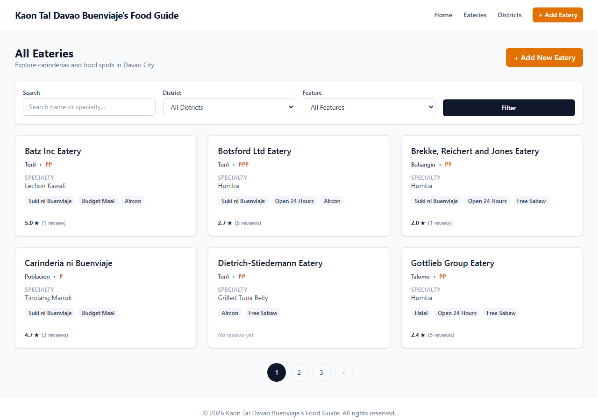
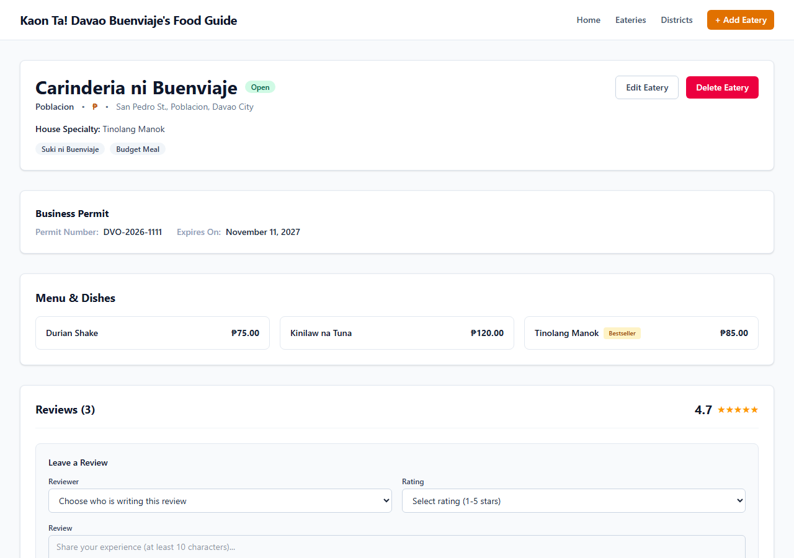
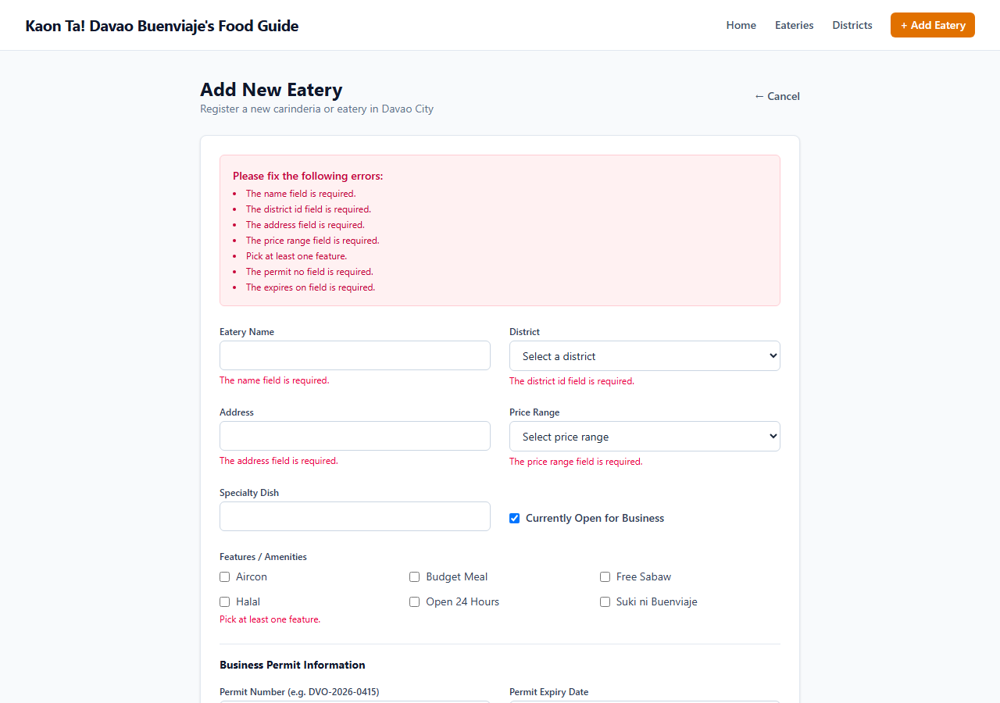

# Kaon Ta! Davao Buenviaje's Food Guide

**Developer:** Brian Buenviaje  
**Course & Section:** CS Elective 2 Full-Stack Development (Laravel) · 4-334  
**Project:** Prefinal Milestone Project – Kaon Ta! Davao: Carinderia & Eatery Guide  

---

## 1. Setup Instructions

To run this application locally, execute the following commands from the project root:

```sh
composer install
cp .env.example .env
php artisan key:generate
touch database/database.sqlite
php artisan migrate:fresh --seed
npm install
npm run build # or npm run dev while developing
php artisan serve
```

The application will be accessible at `http://127.0.0.1:8000`.

---

## 2. Personalized Data

- **Site Title:** `Kaon Ta! Davao Buenviaje's Food Guide`
- **Districts (6):** `Poblacion`, `Talomo`, `Agdao`, `Buhangin`, `Toril`, `Calinan`
- **Features (6):** `Suki ni Buenviaje`, `Budget Meal`, `Halal`, `Open 24 Hours`, `Aircon`, `Free Sabaw`
- **Seeded Users (12):**
  - `Brian Buenviaje` (`buenviaje@kaonta.test`, password `kaonta2026`)
  - `Tita Buenviaje` (`tita.buenviaje@kaonta.test`, password `kaonta2026`)
  - 10 additional factory-generated users
- **Hand-made Eatery:**
  - **Name:** `Carinderia ni Buenviaje`
  - **Slug:** `carinderia-ni-buenviaje`
  - **District:** `Poblacion`
  - **Address:** `San Pedro St., Poblacion, Davao City`
  - **Price Range:** `budget` (₱)
  - **Specialty:** `Tinolang Manok`
  - **Status:** Open
  - **Business Permit:** `DVO-2026-1111` (Expires: `2027-11-11`)
  - **Features:** `Suki ni Buenviaje`, `Budget Meal`
  - **Dishes:**
    - `Tinolang Manok` - ₱85.00 (Bestseller)
    - `Kinilaw na Tuna` - ₱120.00
    - `Durian Shake` - ₱75.00
  - **Featured Review:** By `Tita Buenviaje` (5 stars):  
    *"Lami kaayo! Balik-balikan ni Tita Buenviaje."*

---

## 3. Eloquent Relationships

| Relationship | Type | Explanation |
| :--- | :--- | :--- |
| **District &rarr; Eatery** | `hasMany` / `belongsTo` | A geographic district encompasses multiple carinderias and eateries, while each individual eatery is physically stationed within exactly one district. |
| **Eatery &rarr; Permit** | `hasOne` / `belongsTo` | An eatery possesses exactly one official municipal business permit, and that permit record belongs solely to that specific eatery. |
| **Eatery &rarr; Dish** | `hasMany` / `belongsTo` | An eatery offers a variety of prepared dishes on its daily menu, with each dish belonging to the eatery offering it. |
| **Eatery &rarr; Review** | `hasMany` / `belongsTo` | An eatery gathers feedback and reviews from customers over time, and every review directly references the eatery being reviewed. |
| **User &rarr; Review** | `hasMany` / `belongsTo` | A dining patron or user can write multiple food reviews across various eateries, with each review belonging to the user who wrote it. |
| **Eatery &harr; Feature** | `belongsToMany` / `belongsToMany` | An eatery can advertise multiple features (e.g. Aircon, Halal, Suki), and a single feature tag can apply to numerous eateries via the `eatery_feature` pivot table. |
| **District &rarr; Review** | `hasManyThrough` | A district aggregates all community reviews written across all eateries located in that district through the intermediary `Eatery` model. |

---

## 4. Application Routes

Output of `php artisan route:list --except-vendor`:

```
GET|HEAD / ..................................................................... home › HomeController
GET|HEAD districts ........................................... districts.index › DistrictController@index
GET|HEAD districts/{district} .................................. districts.show › DistrictController@show
GET|HEAD eateries ................................................ eateries.index › EateryController@index
POST eateries .................................................... eateries.store › EateryController@store
GET|HEAD eateries/create ....................................... eateries.create › EateryController@create
GET|HEAD eateries/{eatery} ......................................... eateries.show › EateryController@show
PUT|PATCH eateries/{eatery} .................................... eateries.update › EateryController@update
DELETE eateries/{eatery} ..................................... eateries.destroy › EateryController@destroy
GET|HEAD eateries/{eatery}/edit .................................... eateries.edit › EateryController@edit
POST eateries/{eatery}/reviews ................. eateries.reviews.store › ReviewController@store
GET|HEAD reviewers/{user} ........................................ reviewers.show › ReviewerController@show
DELETE reviews/{review} ........................................ reviews.destroy › ReviewController@destroy
```

---

## 5. Application Screenshots

### Eatery List Page (`/eateries`)


### Eatery Show Page (`/eateries/carinderia-ni-buenviaje`)


### Form Validation Errors (`/eateries/create`)

